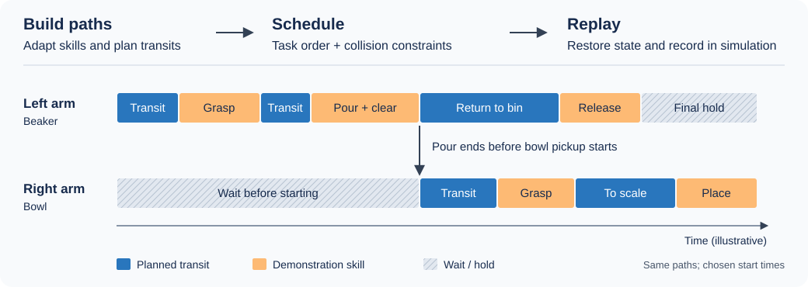

..
   Copyright (c) 2026 NVIDIA CORPORATION & AFFILIATES. All rights reserved.
   SPDX-License-Identifier: Apache-2.0

.. _schedulegen-workflow:

ScheduleGen: Multi-Arm Data Generation
======================================

ScheduleGen generates multi-arm demonstrations by combining object-relative skills,
motion planning, and scheduling. It adapts contact-rich skills from a few demonstrations,
plans the connecting motions, then chooses when each arm moves. The arms can work in
parallel while respecting task order and avoiding the collisions found along their paths.

See `ScheduleGen: Demonstration Generation via Skill Scheduling for Multi-Arm Imitation
Learning <https://arxiv.org/pdf/2610.39429>`_ for the method, experiments, and results.
This page describes the AutoData implementation and walks through **GR1T2 nut pouring**
with a fixed waist, using the same annotated demonstrations for normal and cross layouts.
The paper covers additional tasks and embodiments beyond this example.

.. figure:: ../../../images/schedulegen_gr1t2_cross.gif
   :width: 85%
   :align: center
   :alt: GR1T2 pours from a red beaker into a yellow bowl, returns the beaker to a bin,
         and places the bowl on a scale in the cross layout.

   A generated cross-layout rollout. After pouring and clearing the bowl, the robot can
   return the beaker while the other arm picks up and places the bowl. Playback is at
   the recorded speed.

Workflow at a Glance
--------------------

.. list-table:: GR1T2 nut pouring
   :header-rows: 1
   :widths: 25 75

   * - Property
     - Value
   * - Environment
     - ``AutoData-NutPour-GR1T2-ScheduleGen-v0``
   * - Robot and control
     - Fixed-waist GR1T2, absolute-pose Pink IK, two dexterous hands, 20 Hz control.
   * - Physics
     - PhysX or Arena's Newton/MJWarp preset, with task-specific hand/contact settings.
   * - Source data
     - Five supplied annotated demonstrations, shared by the normal and cross layouts.
   * - Task
     - Pour from the beaker, return it to the bin, and place the bowl on the scale.

.. toctree::
   :maxdepth: 1

   step_1_record_demonstrations
   step_2_annotate_demonstrations
   step_3_generate_dataset
   step_4_validate_dataset

Already have the supplied annotated dataset? Start at :doc:`step_3_generate_dataset`.

How It Works
------------

ScheduleGen builds the paths **before** scheduling them. Scheduling changes their timing,
not their geometry.

1. **Build paths.** Reset and save the initial scene state. Select and transform source
   skills into the new object frames, solve their joint trajectories, and use cuRobo to
   connect them with planned transits. Track when each hand grasps and releases an object.
2. **Find conflicts.** Check the arm paths and held-object geometry for configurations
   that cannot occur together. These checks run on the GPU.
3. **Schedule.** Solve a mixed-integer linear program (MILP) on the CPU with SciPy/HiGHS.
   It inserts waits to avoid conflicts, satisfy task constraints, and minimize the time
   at which all arms finish, called the *makespan*.
4. **Replay and record.** Validate the scheduled motion, restore the saved initial state,
   and execute the commands in simulation. Check task success and export demonstrations
   through AutoData's recorder.

         The bowl arm starts after pouring ends while the beaker arm returns to the bin.

   Scheduling preserves each arm's path order while choosing where to wait. The task
   order shown here is explicit; collision checks may require additional waits.
   Segment lengths are illustrative, not measured timings.

This extends :doc:`SkillGen <../skillgen/index>` from planned single-arm transits to a
joint schedule across arms. AutoData's existing task descriptors, embodiment adapters,
source selection, asynchronous environment stepping, and dataset export remain in use.

Before You Start
----------------

Complete the :doc:`AutoData installation <../../quickstart/installation>` and use the
cuRobo Docker image. Run the following command on the **host**, from the repository root:

.. code-block:: bash

   ./docker/run_docker.sh -c

Run the commands below **inside this container**, from the repository root. ``python``
uses the locked environment at ``/opt/autodata/.venv``, including the scheduling,
robot-model and Pink IK dependencies. No additional package installation is required.

You need a CUDA GPU, cuRobo kernels built for that GPU, and access to the task's USD assets.
The :ref:`SkillGen preflight <skillgen-preflight>` explains the cuRobo and asset checks;
its Franka memory estimates do not apply to this humanoid. Start with one environment.
The first run also builds and caches the robot model and fitted collision spheres.

Source Data and Generation
--------------------------

The included annotated dataset lets you skip recording and annotation. See
:doc:`step_3_generate_dataset` for the Git LFS download, complete generation command,
normal/cross configurations, failure handling and scaling. For your own recordings,
follow :doc:`step_1_record_demonstrations` and :doc:`step_2_annotate_demonstrations` first.

The rest of this page explains the scheduling options and code structure.

Task Order and Motion Continuity
---------------------------------

A subtask can contain named segments, such as a planned ``transit`` and a replayed ``skill``.
Constraints refer to those names, not to how a segment was produced. For example, the
supplied task waits until pouring and clearance finish before starting the bowl pickup:

.. code-block:: yaml

   schedule:
     strategy: waypoint_retiming
     time_limit_s: 15.0
     constraints:
       - type: precedence
         before: left.pour_and_clear.skill.end
         after: right.grasp_bowl.transit.start
         min_lag_steps: 0

An endpoint is written as ``arm.subtask.segment.start`` or ``arm.subtask.segment.end``.
Precedence can relate any of these start/end pairs, with optional minimum and maximum
lags in control steps. ``non_overlap`` keeps two segment intervals disjoint without
choosing their order in advance. The scheduler also preserves each arm's own path order
and adds the collision constraints found for the current attempt.

Two different options affect pauses:

* **Soft continuity cost:** ``minimize_max_wait: true`` (the default) prefers the smallest
  largest internal wait among equal-makespan schedules. It still allows pauses when needed;
  initial start delays and terminal holds are not penalized. Set it to ``false`` for a
  makespan-only objective.
* **Hard non-preemption:** a ``non_preemptive`` constraint forbids inserted waits inside
  a listed chain of consecutive segments on one arm. The scheduler can delay the chain's
  start, but cannot pause it after it starts. This does not remove deliberate holds already
  present in a skill or scripted segment.

For example, the supplied descriptor keeps the beaker's final transport and release together:

.. code-block:: yaml

   - type: non_preemptive
     segments:
       - left.release_beaker.transit
       - left.release_beaker.skill
       - left.release_beaker.open_hold

The right arm likewise has a continuous pickup-to-placement chain. These constraints do
not serialize the two arms: the scheduler can overlap the chains when task order and
collision checks allow it. The supplied example uses **both** hard chains and the soft cost.

For coarser timing, ``strategy: block_scheduling`` keeps each block internally continuous;
``max_block_size: 0`` makes each segment a single block. Waypoint retiming instead permits
waits between individual waypoints unless a hard chain forbids them. Both strategies use
the same solver and constraint types.

.. _schedulegen-generation-modes:

Choose a Generation Mode
------------------------

Both modes plan paths, schedule them, and replay the accepted schedules. They differ in
how planning contexts and simulation environments are used:

.. list-table:: Generation modes
   :header-rows: 1
   :widths: 22 39 39

   * - Mode
     - Planning and scheduling
     - Replay
   * - ``per_environment`` (default)
     - Each environment owns its planner context and generates its own candidate.
     - Environments execute through AutoData's shared asynchronous stepping loop.
   * - ``buffered``
     - One planning context builds a buffer of candidates. Independent CPU schedule
       solves can use ``--schedule_workers``; GPU planning and validation remain serial.
     - Restore each accepted candidate's initial state and replay the batch across
       ``--num_envs`` environments, allowing different episode lengths.

See :doc:`step_3_generate_dataset` for a buffered generation example.

``--schedule_workers`` applies only to buffered mode. It parallelizes MILP solves, not
cuRobo planning. Per-environment mode uses more planner memory as ``--num_envs`` grows;
buffered mode shares that memory but still needs simulation and replay buffers. More
environments do not guarantee faster generation or the same physical success rate.

Inspect Plans and Rollouts
---------------------------

Use :doc:`step_4_validate_dataset` to check the exported data, inspect simulator videos
and view planned paths in Rerun. The front viewport is separate from the robot's observation
camera. Simulator video recording currently supports one environment; plan visualization
shows environment 0.

Inspect the object frames, held-object geometry, planned transits, and actual contacts in
the rollout. A valid schedule is not proof of a successful grasp or pour. If an attempt
fails, use its JSON diagnostics and video to distinguish planning failures, infeasible
constraints, validation failures, and physical task failures before changing the settings.

Where to Look in the Code
-------------------------

* **ScheduleGen** (:autodata_code_link:`<autodata_core/schedulegen/algorithm.py>`) builds,
  schedules, validates, and replays complete episodes through the generation interface.
* **Path building** (:autodata_code_link:`<autodata_core/schedulegen/path_builder.py>`) adapts
  source skills and connects them with motion plans.
* **Scheduling** (:autodata_code_link:`<autodata_core/scheduling/retiming.py>`) implements
  the MILP independently of this task and robot.
* **Buffered generation** (:autodata_code_link:`<autodata_core/schedulegen/batching.py>`)
  shares planning contexts and uses the existing asynchronous replay loop.
* **cuRobo setup** (:autodata_code_link:`<autodata_interfaces/motion_planners/curobo/planner_factory.py>`)
  builds named planning groups using the robot's kinematic model, generated configs,
  fitted collision spheres, and self-collision pairs. See also
  :doc:`motion planner configuration <../../advanced/motion_planners>`.

To adapt the example, start with its task, embodiment, robot-planning, and environment
configurations. Keep scene-specific reset ranges and contacts there rather than adding
task branches to the scheduler. Re-annotate source skills and object events when their
boundaries change, then check one complete generated episode before scaling up.

.. _schedulegen-citation:

Citation
--------

If you use ScheduleGen in your research, please cite our paper:

.. code-block:: bibtex

   @misc{jawale2026schedulegendemonstrationgenerationskill,
     title = {ScheduleGen: Demonstration Generation via Skill Scheduling for Multi-Arm Imitation Learning},
     author = {Neel Jawale and Stephan Pleines and Soha Pouya and Yuke Zhu and
               Ajay Mandlekar and Caelan Garrett},
     year = {2026},
     eprint = {2610.39429},
     archivePrefix = {arXiv},
     primaryClass = {cs.RO},
     url = {https://arxiv.org/abs/2610.39429},
   }
