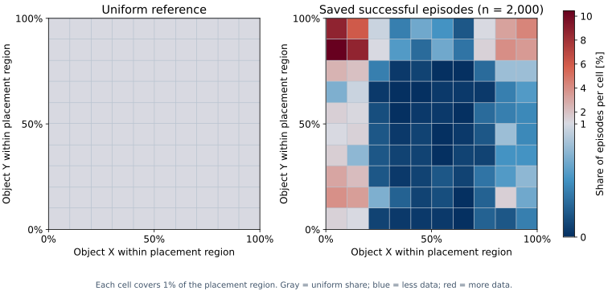
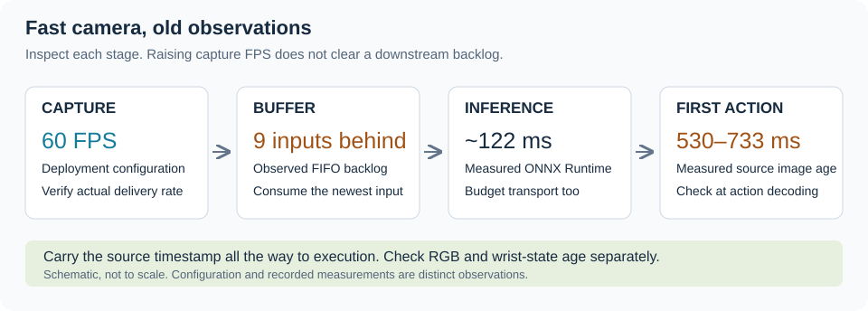

Sim-to-Real Workflow
====================

The purpose of this guide is to provide recommendations that can be applied to an existing
simulation workflow to improve sim-to-real transfer. The sections below follow the pipeline in
order, from environment construction to deployment. The examples in this workflow are based on
experiments done with a Unitree G1 humanoid robot on an apple pick-and-place task. The primary policy
controls bimanual manipulation while a lower-body controller keeps the robot standing. This guide is
not a universal recipe, so choose the recommendations that best fit your setup.

.. warning::

   It is assumed that you already have a complete workflow from environment construction to
   deployment. We recommend working through :doc:`an example workflow <humanoid_dexmimicgen/index>`
   before using this guide.

Environment Setup
-----------------

Start by bringing the simulated scene and robot behavior close to the real setup.
The following sections cover workspace reconstruction, domain randomization,
controller selection, and the observations available to the policy.

Real-to-Sim Reconstruction
^^^^^^^^^^^^^^^^^^^^^^^^^^

Real-to-sim reconstruction recreates your real workspace in simulation. Matching the
objects, layout, and appearance helps the policy handle the views and interactions
it will encounter on the robot.

Record a 360° walkthrough video around the real workspace, showing the objects, robot, and
background from several angles. Measure key dimensions such as table height, tabletop
size, task-object dimensions, and robot-to-table distance to ground the reconstruction
and give it a reliable scale. The more angles and views you record, the better the reconstruction will be.

.. figure:: ../../images/sim2real/real2sim_grid.png
   :width: 100%
   :align: center
   :alt: Matched workspace views with real images on the top row and simulation on the bottom row

   Real workspace (top row) and reconstructed simulation (bottom row), viewed from matched angles.

Give these references and known constraints to a coding agent. In the image above, an agent running
GPT-6 Astra reconstructed the scene in Isaac Lab Arena by designing and placing assets, adjusting
materials and lighting, and iterating against real frames with human feedback. Thoroughly review
each object's shape, scale, placement, and appearance before continuing.

.. tip::

   Download `Blender <https://www.blender.org/>`_ and give the agent its executable path so it can
   model missing assets as needed. Provide measured dimensions and review the resulting geometry in
   Arena before accepting the asset.

.. dropdown:: Example agent prompt: reconstruct the workspace

   Adapted from the prompt used for the workspace reconstruction:

   .. code-block:: text

      Reconstruct the workspace in Arena from <360_walkthrough_video>.
      Use Blender at <blender_path> to model missing assets as needed.
      Review every object's geometry, scale, placement, and collision shape
      against the reference footage and <measurements>. Adjust lighting,
      materials, and textures to match the real scene.
      Preserve the verified dimensions and constraints in <measurements>.
      If an existing scene exists, improve it rather than starting from scratch.
      Iterate: compare renders, identify mismatches, fix them, and repeat.
      After each pass, show matched views with real images on the top row
      and updated simulation on the bottom. Record unresolved mismatches for human review.

Camera alignment is another integral part of real-to-sim reconstruction. Record the
robot's egocentric view across several poses so the simulated camera can be matched to
what the policy will see on hardware. A rosbag containing images, camera-info messages,
TF transforms, and robot states will provide a good estimate of the camera intrinsics
and mount pose. Again, task a coding agent like GPT-6 Astra with correctly reconstructing the camera parameters.

.. figure:: ../../images/sim2real/camera_alignment.gif
  :width: 100%
  :alt: Recorded real motion replayed in the original and corrected simulated scenes

  Replay recorded robot states. Alignment should hold as the hands move, not just in the first frame.

.. dropdown:: Example agent prompt: check camera alignment

   Adapted from the prompt used for the workspace reconstruction:

   .. code-block:: text

      Align the simulated egocentric camera with <ego_recording>.
      Use camera-info messages and TF from <rosbag>, when available, to
      initialize intrinsics and extrinsics. Refine the alignment against
      robot landmarks and workspace edges across several poses, and hold
      out frames for validation. Keep verified scene geometry fixed.
      Match exposure and white balance, and adjust scene lighting intensity
      and color temperature to reproduce the recorded appearance.
      Compare the images after the policy's resize and preprocessing.
      Show matched views with real images on the top row and simulation
      on the bottom. Report remaining errors before making another change.

Domain Randomization
^^^^^^^^^^^^^^^^^^^^

Even after reconstruction, object placements, robot starting configurations, appearance,
and camera mounting may differ from reality. Randomizing these parameters during data
generation will help the training data cover the conditions expected on the robot. Choose
reasonable bounds for variation, as ranges that are too narrow will leave gaps and broad ranges
may lead to lower data generation yield and degraded policy performance.

.. list-table:: What to Randomize
   :widths: 25 45 30
   :header-rows: 1

   * - Family
     - Cover
     - G1 example
   * - Object placement
     - Reachable starts and goals, including workspace edges.
     - Apple: 13 × 15 cm; plate: 4 × 4 cm.
   * - Robot start
     - Initial arm posture; check wrist displacement after settling.
     - ±5° per joint.
   * - Appearance
     - Illumination, exposure, color temperature, and meaningful material variation.
     - Color temperature: 2500-8500 K.
   * - Camera
     - Residual focal-length and mount uncertainty after calibration.
     - Focal length ×[0.96, 1.04]; mount ±5 mm and ±3°.

These ranges were designed for a specific setup and should serve as guidance for choosing your own.
Check that the robot can reach every part of the object-placement region, lighting
changes keep the task visible, and randomized robot starting configurations do not intersect with nearby
objects.

Controller Setup: cuMotion and PINK IK
^^^^^^^^^^^^^^^^^^^^^^^^^^^^^^^^^^^^^^

This consideration is relevant for policies that output end-effector poses because inverse kinematics
(IK) is required to convert the policy output into joint space targets. Policies that output joint targets
directly bypass this step.

PINK IK is the default controller used in our simulation-based workflows, while cuMotion/RMPFlow
is the default controller used in our deployment workflows. In our experimental setup, we observed
better policy performance in both simulation and real deployment with using cuMotion/RMPFlow in
simulation during both teleoperation and data generation.

We therefore recommend comparing controllers on your task and checking which gives
better tracking and policy performance in both simulation and deployment. Where
practical, use the same controller throughout teleoperation, generation, and deployment.

Standing Controller: AGILE
^^^^^^^^^^^^^^^^^^^^^^^^^^

Our setup uses AGILE to keep the G1 standing while the manipulation policy commands the
upper body. Initially, simulation and deployment used different AGILE checkpoints, and
the simulated pelvis and table were both 6 cm higher than their real counterparts.
Standardizing the checkpoint and pelvis height did not produce a clear improvement in
transfer in our experiments. Compare these settings on your robot, since changes in
stance can affect camera pose and reach.

.. Reset the controller's history independently for each environment, initialize it from
.. fresh reset observations, and let the robot settle before recording or acting. The G1
.. adapter primes history with 150 stationary inference calls; this initializes controller
.. memory without advancing physics, so check physical settling separately. Measure pelvis
.. drift and wrist position over a rollout, not just at reset. Also check the export's
.. inputs: the velocity-only AGILE export has no height command, so a pelvis-height setting
.. elsewhere in the simulator cannot be assumed to control it.

Choose the Observation Set
^^^^^^^^^^^^^^^^^^^^^^^^^^

We compared policies trained with joint positions, wrist poses relative to the pelvis,
and both observation groups together. Combining them reduced success in simulation but
produced better trajectories on the real robot. Compare observation sets in both
settings before deciding which inputs to keep.

Teleoperation
-------------

To improve policy performance in simulation and on the real robot, we recommend
teleoperating with slow and smooth motions. Do not rush grasping or releasing objects,
as gripper behavior may vary between sim and real. We find that
`optimizing XR Performance <https://isaac-sim.github.io/IsaacLab/v3.0.0-EA/source/features/isaac_teleop.html#optimize-xr-performance>`_
before collecting seed demonstrations can improve data quality by achieving a higher
data capture frequency during teleoperation.

Keep state-based domain randomization enabled during teleoperation so the seed
trajectories cover the object placements and initial robot configurations used during
generation. Randomized seeds led to about 75% generation success, versus 9% without
randomization; the latter dataset also missed parts of the intended distribution.
Visual randomization is optional during teleoperation because the objective is to
capture varied motions, and visual diversity is added during data generation.

Data Generation
---------------

Waypoint Noise
^^^^^^^^^^^^^^

Waypoint noise perturbs generated wrist targets at each step, consistently adding variation across entire trajectories.
By forcing the dataset to contain a greater variety of states, this process improves policy robustness.
However, adding too much waypoint noise can prevent successful task completion, as shown in the GIF below.

.. figure:: ../../images/sim2real/waypoint_noise_sweep.gif
   :width: 100%
   :align: center
   :alt: The same source demonstration replayed with increasing waypoint position and rotation noise

   Same source demonstration and scene, with increasing waypoint noise. The sweep
   includes extreme values to show the effect of adding too much noise.

Audit the Applied Randomization
^^^^^^^^^^^^^^^^^^^^^^^^^^^^^^^

After running data generation, it is important to audit the resulting dataset to ensure that the
full range of domain randomization has been evenly applied.

* **Effect:** compare several resets and a complete rollout. Inspect sampled poses,
  first-frame grids, camera parameters, and materials. Verify that static properties
  vary between episodes and remain stable within each one.
* **Coverage:** compare sampled starts with saved successful starts. AutoData's success
  filter can remove the difficult layouts that randomization was meant to cover.

   Initial object placements from 2,000 saved successful demonstrations, compared with
   a uniform reference. Some regions have little or no data. Compare sampled and saved
   starts to determine whether gaps come from the sampler or success filtering.

.. code-block:: bash

   # Placeholder: audit both attempts and saved episodes.
   python <audit_domain_randomization.py> \
       --dataset <generated.hdf5> --attempts <attempts.jsonl> \
       --profile <sim2real_dr.yaml>

Policy Training
---------------

Absolute and Chunk-Relative Actions
^^^^^^^^^^^^^^^^^^^^^^^^^^^^^^^^^^^

Absolute wrist actions predict targets in a fixed robot frame. Chunk-relative actions
predict every target in a chunk relative to the measured wrist pose at its latest
observation. Unlike step-relative actions, they use **one fixed anchor for the whole
chunk**. This can make the predicted motion less sensitive to the absolute start pose.

.. figure:: ../../images/sim2real/action_types.png
   :width: 100%
   :align: center
   :alt: Diagram comparing fixed-frame absolute targets, step-relative actions, and chunk-relative actions

   Absolute, step-relative, and chunk-relative actions use different references.
   Training and deployment must agree on when the reference is captured.

The G1 comparison improved simulated success from 64% to 72% with chunk-relative wrist
actions. It is an optional policy experiment, not a required core change. Tracking lag
still matters: anchoring each new chunk to a hand that trails its target can accumulate
drift. Compare full real trajectories as well as simulation scores.

.. dropdown:: Example agent prompt: add chunk-relative actions

   .. code-block:: text

      Add an opt-in chunk-relative action representation to <policy>.
      Anchor every wrist target to its measured pose at the latest observation;
      keep that anchor fixed through the chunk. Match position/rotation
      conventions in training, rollout, and export. Leave gripper and non-pose
      channels unchanged. Verify encode/decode round trips and native/export
      agreement, then compare with the absolute-action baseline on fixed layouts.

End-Effector and Joint-Space Actions
^^^^^^^^^^^^^^^^^^^^^^^^^^^^^^^^^^^^

The absolute end-effector actions in this workflow specify each wrist's target position
and orientation relative to the pelvis. IK or a motion controller converts that target
transform into arm joint targets. Joint-space actions predict those targets directly,
removing that conversion but making the policy responsible for the coordinated joint
motion. Both still depend on the deployed joint controller's tracking and limits.
Joint-space actions did not show a clear gain in the randomized G1 comparisons.
Compare the two with matched observations, data, and evaluation layouts, and update
the export and deployment decoder whenever the action representation changes.

Visual Inputs and Augmentation
^^^^^^^^^^^^^^^^^^^^^^^^^^^^^^

Crop Randomization
~~~~~~~~~~~~~~~~~~

Crop randomization is a classic data augmentation technique that helps when the camera
view is fixed. A humanoid's egocentric camera moves as the robot balances while its arms
move, so the natural head motion already provides viewpoint variation. In our experiments,
additional crop randomization hurt performance and often removed the object from view.

.. important::

   For robomimic policies, inspect crop randomization. In early G1 experiments,
   the default square crop often excluded the apple. Increasing the crop to 90% of
   the image height and width raised success in simulation from 44% to 50%; removing the
   crop entirely raised it to 82%. Check actual training batches across approach,
   grasp, and placement before accepting an augmentation.

.. figure:: ../../images/sim2real/policy_crop_issue.png
   :width: 90%
   :alt: Square crop windows remove the task object from egocentric training images

   A crop that removes the task is a data problem, even when the uncropped image looks correct.

Visual Dropout
~~~~~~~~~~~~~~

A blind variant of the policy that was only trained on proprioception observations produced
reasonable trajectories on the real robot, and completed the task when the apple was placed
at certain positions. The traditional visuomotor policy struggled, suggesting that the
visual input was a source of transfer error. This experiment motivated the use of visual dropout,
randomly masking visual observations during training to encourage the model to rely more on
proprioception.

In our experiments, masking 10% of the frames during training produced smoother, more stable,
and more accurate real trajectories without a measurable change in performance in simulation.
Note that visual dropout was only performed during training and not during sim or real
evaluation.

Depth Observations
~~~~~~~~~~~~~~~~~~

Adding depth alongside RGB provided geometry information and produced more accurate
real trajectories in our experiments. Match the transform between the RGB and depth
cameras in simulation and on the robot, including any registration of depth into the
RGB view. We applied visual dropout independently to RGB and depth observations during
training. Compare RGB-only and RGB-D policies, with and without dropout, on the same
layouts to assess the effect in your setup.

Diffusion Steps and Action Horizon
^^^^^^^^^^^^^^^^^^^^^^^^^^^^^^^^^^

Select denoising steps using rollout quality and latency. The G1 sweep tested
10, 20, 50, and 100 DDPM steps at four learning rates each. Fewer steps lowered training
loss without consistently improving success; the baseline uses 20. Distinguish the
training noise schedule (``num_train_timesteps``) from the denoising iterations used
per prediction (``num_inference_timesteps``). The baseline sets both to 20; changing
inference steps alone is a separate experiment. Remeasure chunk latency and task success
after a change rather than assuming more steps improve the action.

Action horizon is how many predicted actions run before replanning. The baseline
predicts 16 actions but executes six, then requests a new chunk. Shorter execution
horizons give more frequent feedback but require inference to keep up; longer horizons
reduce replanning demand but can continue a stale or inaccurate reach. Compare horizons
on fixed layouts while measuring observation age, tracking lag, and late chunks. Six
actions span 120 ms at 50 Hz and 240 ms at 25 Hz: changing playback rate also changes
the time spent executing a chunk, even when the configured horizon stays the same.

Other Training Comparisons
^^^^^^^^^^^^^^^^^^^^^^^^^^

The comparisons below include changes that had little or negative impact in our
experiments, alongside changes that helped in some configurations. They can inform
which experiments to prioritize, but we still recommend testing them on your task:
their effect on simulation and transfer may differ in another setup.

.. list-table::
   :widths: 35 65
   :header-rows: 1

   * - Change
     - Observed effect and next check
   * - RGB pixel noise
     - Little change in simulated success (72.3% to 72.1%). Prioritize alignment and coverage first.
   * - Higher image resolution
     - Helped in the sweep (240 × 320 to 480 × 640); remeasure inference latency before deploying.
   * - Joint-space actions / more waypoint noise
     - No clear gain in the later randomized comparisons. Neither replaces controller matching.
   * - DiT / pretrained visual encoder
     - DiT improved simulated success in one sweep; the DINOv2 run was incomplete and did not establish a benefit.

Evaluation
----------

Real Deployment
---------------

Export the Policy with Runtime Diffusion Noise
^^^^^^^^^^^^^^^^^^^^^^^^^^^^^^^^^^^^^^^^^^^^^^

The LEAPP integration exports a complete robomimic diffusion-policy action chunk to
ONNX. Export on a step that actually runs denoising, rather than returning an action
cached in the policy's queue. Supply observation history explicitly and check the
exported preprocessing, action decoding, and output shape against the native policy.

Make initial diffusion noise an explicit input. A random tensor created during
tracing can become a captured constant, causing repeated sampling after export. The
integration accepts caller-supplied noise, annotates ``diffusion_noise`` as an input,
and supplies fresh noise at runtime. This export support is reusable independently of
whether the policy uses absolute or chunk-relative actions.

For parity checks, hold the observations and stochastic inputs fixed. DDPM can also
sample variance noise during denoising; preserve or explicitly control that behavior
when comparing native and exported execution. A fixed seed is a diagnostic setting,
not evidence that a deployment is drawing fresh noise.

.. dropdown:: Example agent prompt: make diffusion-policy export reproducible

   .. code-block:: text

      Export <robomimic_DP_checkpoint> through LEAPP as a complete action chunk.
      Expose initial diffusion noise as an explicit graph input and generate
      fresh noise in the runtime. Inspect stochastic scheduler steps too.
      Compare native and exported outputs using identical observations and
      controlled noise, then verify that runtime noise changes between requests.
      Preserve existing behavior when export is disabled.

Fresh Observations and Chunk Timing
^^^^^^^^^^^^^^^^^^^^^^^^^^^^^^^^^^^

Increase real camera Hz when capture limits freshness, and remove downstream backlogs.
The G1 deployment uses 60 Hz RGB capture resized to the policy input resolution. Verify
the delivered rate, image age, and exposure at that rate; a 60 Hz camera does not help
if inference still drains old frames from a queue.

.. code-block:: bash

   # In the robot's ROS 2 environment; substitute the policy camera topic.
   ros2 topic hz /<policy_camera>/image_raw
   ros2 topic delay /<policy_camera>/image_raw

Carry the source timestamp through observation assembly, inference, and action decoding.
Check wrist-state age separately: about 19 Hz TF updates left consecutive history
entries identical in 61–64% of recorded inputs. Faster RGB cannot fix stale proprioception.

   Measure image age when the first action executes, not just when the camera publishes.

The deployment changes add configurable latest-only inference queues, timestamp
propagation, stale-observation/action checks, and timing telemetry. They address a
recorded FIFO backlog of nine inputs and image ages of 530–733 ms at first action.
Configure the age limits and late-chunk behavior for your policy; inspect logs to confirm
the settings are active.

Budget the entire chunk loop. Six actions cover 120 ms at 50 Hz; measured ONNX Runtime
inference alone took about 122 ms. Reduce inference cost or adjust the executed horizon
and playback rate. Longer chunks cover latency but spend more time without new feedback.

Tracking, Hands, and Real Comparisons
^^^^^^^^^^^^^^^^^^^^^^^^^^^^^^^^^^^^^

.. figure:: ../../images/sim2real/action_tracking.gif
   :width: 100%
   :alt: Predicted wrist motion and tracked targets visualized beside robot camera views

   Compare the predicted chunk, executing target, controller reference, and measured hand.

Slowing command playback from 50 Hz to 25 Hz helped the G1's RMPFlow tracking. A search
over controller gains reduced reference-trajectory tracking error by about 15%. Tune
against measured motion rather than command rate alone, and check smoothing or
position-gated action advancement separately: both alter the policy's effective timing.

Inspect hand closure and release independently. One measured finger took 1.85 s to
reach 90% of a command, versus 0.24 s in simulation. Match gains and rate limits; do not
expect accurate wrist tracking to compensate for lifting before the fingers close.

Use a small, fixed set of real layouts and change one factor at a time. Record failures
by approach, grasp, transport, and release. Use Viser/replay diagnostics to separate
constant alignment errors from controller lag and stale inputs. Keep model identity,
normalization, calibration, controller settings, and runtime parameters with the export;
compare policies on the same conditions rather than ranking their unmatched sim scores.

Repository Changes
------------------

The review below covers sim-to-real commits and local tracked/untracked work across
the five checkouts and their experiment worktrees. **Candidate for main** means reusable
code to extract, review, and test in its owning repository. **Keep optional/local** means
an experiment, deployment profile, or artifact to retain outside the core change.
Mixed files need to be split; this is a proposed scope, not a commit or push plan.
Links point upstream, where these changes may not yet be available.

.. list-table:: Proposed Upstream Scope
   :widths: 18 43 39
   :header-rows: 1

   * - Repository
     - Candidate for main
     - Keep optional/local
   * - `AutoData <https://github.com/isaac-sim/AutoData>`_
     - Typed DR configs/profile loading; lighting, material, camera, and local-light
       utilities; DR wiring in generation; event-mode support; dataset rerendering;
       reset-settling and final-success qualification hooks; accompanying tests and
       general audit guidance. Extract reusable job templates and build-context fixes.
     - Fitted task-specific DR profiles and ranges, task-specific success thresholds,
       experiment launchers and OSMO resource/storage settings. Fork URLs, worktree
       rules, installer edits, local paths, and generated job outputs are not part of
       the sim-to-real core patch.
   * - `Isaac Lab-Arena <https://github.com/isaac-sim/IsaacLab-Arena>`_
     - General robomimic DP rollout and LEAPP export; multi-environment queues/history
       and reset fixes; observation copying and quaternion handling; camera/HDF5
       preprocessing and rerendering; recording timestamps; placement seeding and
       generic event/termination fixes; an opt-in cuMotion/RMPFlow backend, controller
       selection, tracking tools, and camera utilities. Generalize the experiment/config plumbing and tests.
     - Lab-specific apple/plate/box tasks, lab USDs/materials, camera extrinsics, robot start
       states, AGILE checkpoint/gain profiles, and placement bounds. Keep fitted
       G1 XRDF/RMPFlow profiles separate from the reusable controller backend.
       Residual-policy variants, timing emulation, action
       conversion/statistics experiments, research notes, and exported bundles remain optional.
   * - `Isaac Lab <https://github.com/isaac-sim/IsaacLab>`_
     - robomimic v0.5 compatibility and reusable training/resume/dataset handling;
       recorder pause and reset-settling support; calibrated camera/schema and authored
       recording-camera support; independent render views; PhysX/Fabric startup fixes;
       config serialization/import-order and CloudXR lifecycle fixes, with regression
       tests and changelogs. Review each as a separate upstream fix.
     - Sweep JSONs, task-specific training configs, evaluation shell loops, machine/env
       paths, hand-tuned assets and rendering presets. Extract generic training code
       from Arena-specific experiment-directory imports. Residual RL adapters and
       their runner settings are a separate optional feature, not required for this recipe.
   * - `robomimic <https://github.com/ARISE-Initiative/robomimic>`_
     - Caller-supplied initial noise for LEAPP export; explicit stochastic-scheduler
       handling and parity checks; general observation-shape/layout and loader fixes.
       Choose one camera-storage contract: standardize datasets in preprocessing or
       submit configurable alternate-group loading only if it is independently useful.
     - Chunk-relative actions and their statistics/normalization are optional policy
       work, not a core prerequisite. Keep DiT, DINOv2, residual PPO, RGB-D, and visual
       dropout comparisons as opt-in extensions/configs; separate any general bug fixes
       from the experiment implementations and training-script cleanup.
   * - `Isaac ROS deployment workspace <https://github.com/NVIDIA-ISAAC-ROS>`_
     - Reusable Triton queue controls, source timestamps, request timing, memory/
       inference reliability fixes; stale-input/action handling; controller-launch
       fixes and safety-command telemetry/tests. Extract generic observation/chunk
       interfaces, diagnostics/replay tools, and model/runtime identity checks for
       review in the owning packages. The link covers the upstream projects; the
       development workspace is an internal monorepo.
     - G1 camera/exposure profiles, controller gains and initial poses, joint-action/
       GR00T adapters, dashboard layout and placement overlays, freedrive and tuning
       presets, network/Docker/MPS settings tied to the machine. Keep fixed release
       manifests, recorded videos/bags, model bundles, and Halloween/demo assets out
       of the core transfer patch.

Untracked files need the same review as committed code. Tests belong with the reusable
change they verify; generated datasets, checkpoints, logs, comparison media, and cluster
credentials do not belong in that source patch. Replace local values with documented
inputs before proposing a reusable example.
